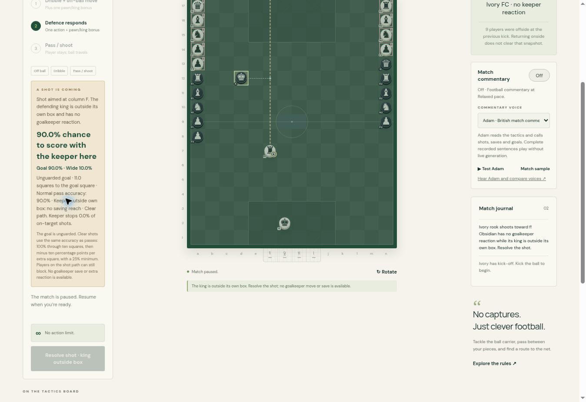

# Unguarded-goal accuracy

Shot model version 19 uses ordinary passing accuracy whenever the defending goalkeeper is outside its own box or absent. An unobstructed shot therefore scores with probability `passAccuracy(distance(origin, selectedGoalSquare))`: 100% through ten grid squares, 90% at eleven, 80% at twelve, and a 25% floor. Distance uses the same maximum-coordinate-difference measure as ordinary passes; diagonal steps are counted consistently. The half-square goal plane remains unchanged for geometric blocking and keeper calculations.

Empty-net shots have no shooting-angle, piece-type or direct-free-kick multiplier. This also applies to a penalty if its goalkeeper is outside the box. A goalkeeper in its own box retains the existing shot model, direct-free-kick bonus and fixed 80% penalty rule. The outside goalkeeper remains an ordinary potential blocker, and existing teammate obstruction, defender blocks, offside and legal kicking patterns still apply. Disguised shots evaluate both target paths with the same rule. Keeper reaction previews and actual resolution share the calculation; Tactical's penalty evaluation also uses the real probabilities.

The live explanation identifies normal pass accuracy and the absence of keeper reactions. Penalty labels and target descriptions use the current odds. Match recordings continue to replay their recorded outcomes without recalculation.

Validation: 244 core and UI checks passed; a further 278 regression checks passed (two UI checks overlap). Coverage includes both teams, short/long/diagonal kicks, multiple piece types, exact goal/miss thresholds, blockers, a keeper leaving its box, missing keepers, set pieces, disguised shots, pending-shot normalization, existing keeper saves/rebounds, ratings, archives and post-match analysis. Native browser QA confirmed a clear eleven-square shot displays Goal 90% / Wide 10%, with the matching explanation. Temporary fixture HTML was removed before packaging.

