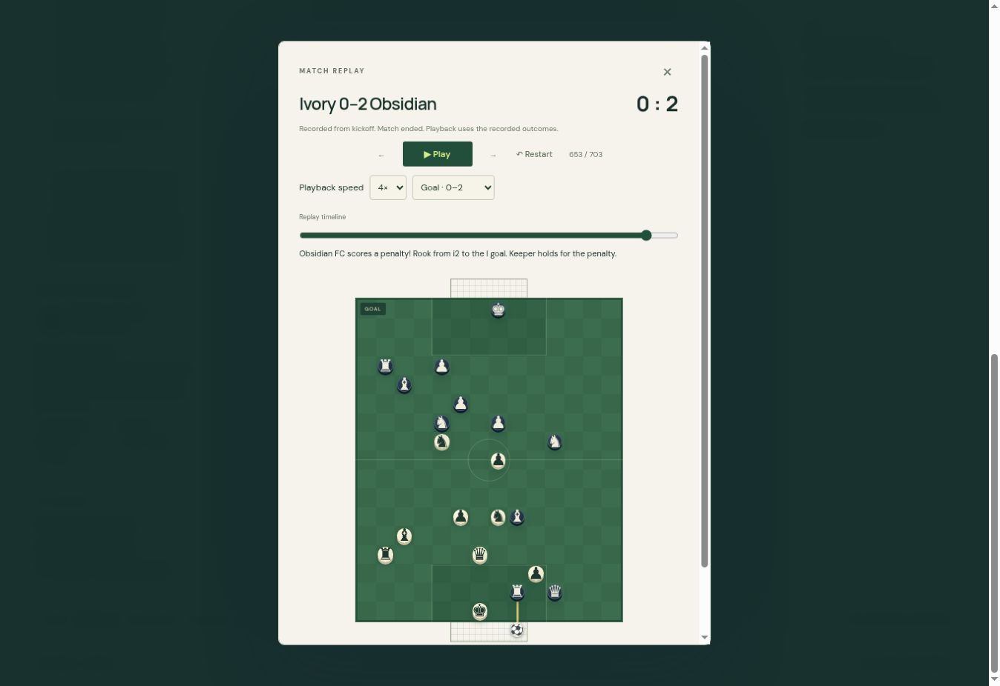

# Portable match recordings

The match toolbar and final result now offer Save / load match. Players can download gzip-compressed JSON as `.fcmatch`, or ordinary `.json`, and open either in the isolated replay board. Full-match playback has a timeline, previous/next actions, 1×/2×/4×/8× speeds and goal jumps. Loading does not replace the current game. Match clocks, AI and commentary suspend while dialogs are open.

Recordings store the initial frame and changed positions, cards, ball, score and action details. Actual outcomes are replayed without calling the engine or AI. Goals include the impact scene before the native kickoff reset. New games record from kickoff; older version-4 saves import only their available undo history and are labelled partial. Recordings persist with the device save, and Undo truncates the relevant future. If storage is tight, the save first reduces duplicate Undo snapshots while retaining the recording. The recording limit is 20,000 steps, with an explicit notice if reached.

File parsing uses a bounded known schema: 32 MiB input and expanded JSON limits, current board dimensions, supported format/rule versions, valid player identities and coordinates, roster transitions, and score progression. Files stay in the browser; no upload service is used. Exports include a visible direct download link as well as the download button.

Validation:
- 196 targeted archive/replay/clock/statistics/foul checks passed across the final suites, including a 700-action native match and compressed/JSON round trips.
- The simulated 0–2 match has 703 frames; compressed size 15,735 bytes versus 178,210 JSON bytes.
- Both goals retain their impact position and reset for subsequent play. Browser QA loaded the compact recording and jumped to its second penalty goal.
- Browser QA recorded 24 fresh actions from kickoff, restored all 24 after reload and reduced the recording to 23 after Undo.
- Legacy 6–0 device save import verified as 80 recorded steps, partial, score unchanged; private input is not included in this repository.
- Local preview generates both downloads. The cloud browser did not provide a preview download event; final HTTPS production download verification follows deployment.

