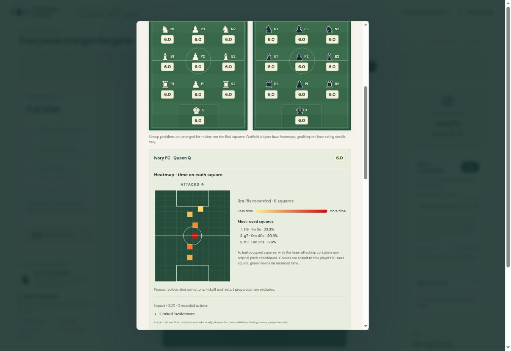

# Post-match player heatmaps

After full time, select any outfield player in the player-ratings lineup to see their heatmap alongside their rating. The detail panel scrolls into view. Goalkeepers retain rating details only. No heatmaps appear during play or in paused-match statistics.

The heatmap records elapsed active play time on each actual 14 × 17 pitch square. It does not infer movement paths between squares. Kickoff, restart preparation, pauses, dialogs, replays and shot animations are excluded. Time is sampled by the existing match-clock flush, before actions change the position, including in untimed matches. Both teams are shown attacking upward; Obsidian is rotated through 180 degrees, while square labels retain original pitch coordinates.

Yellow-to-red cells show time relative to that player’s busiest square. Green means no recorded time. The panel includes total recorded time, distinct squares and the three most-used squares with durations and percentages. Removed players retain their earlier records; players taking over as goalkeeper stop accumulating outfield time.

Sparse occupancy records live inside match statistics, so saving, reloading and undo use the existing match history. New matches clear the records. Older saved matches explicitly show missing or partial history instead of reconstructing it from the final lineup. Old pre-match setups begin with complete empty records.

Validation: 179 focused tests cover ratings, stats, clock gating, occupancy, orientation, goalkeeper exclusion, dismissals, save/reload/undo, legacy data and player selection. Browser checks verified both teams, goalkeeper exclusion, reload persistence and a 390px mobile viewport without horizontal overflow. The screenshot uses a deterministic local test match; fixture pages were removed before publishing.

