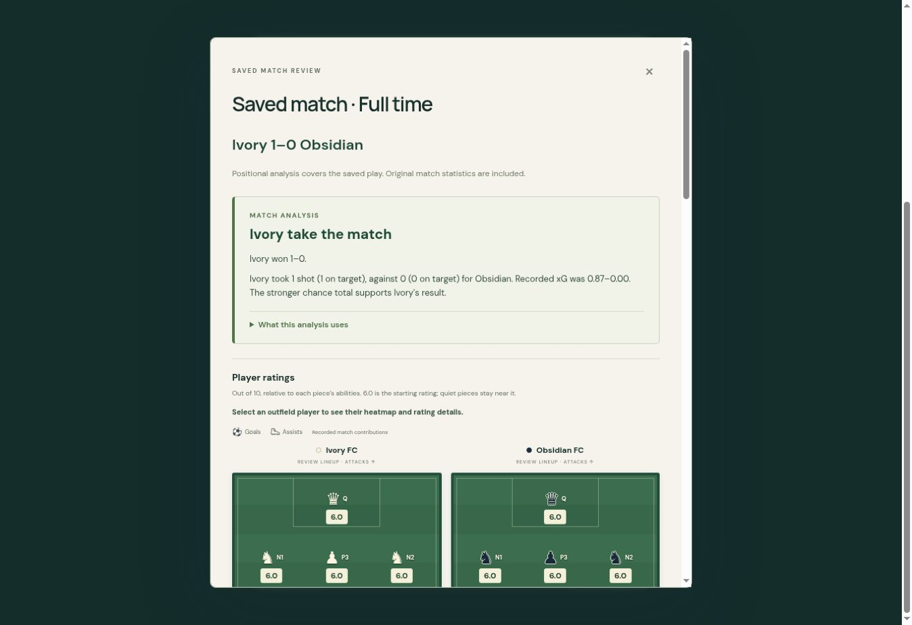

# Post-match analysis and saved-match reviews

Full time now includes an immediate local narrative based on recorded match events, shot probabilities and sampled player positions. No language model, network service, API key or model download is needed. The report distinguishes observed patterns from tactical suggestions and exposes its evidence and data coverage.

The analyzer compares shots, shots on target and recorded xG, highlights dismissals and repeated contributors, and can identify sustained high defensive lines, central crowding, long-range shooting and possession that did not produce the stronger chances. Geometry is sampled from open-play movement frames; position samples are never presented as elapsed time. It does not attribute a score to luck or establish a causal effect from team shape.

New compact/JSON match exports carry validated original statistics, player ratings and timed heatmaps as an optional field. Existing files remain readable: reconstructable event totals are shown while possession time, assists, ratings and timed heatmaps are identified as unavailable. Invalid optional statistics are discarded without breaking a valid replay. A mismatched or capped recording cannot silently receive statistics from a different final position.

Saved-match playback now supports automatic goal clips, manual goal replay, return to the exact match position and playback speed, and a statistics/analysis review. The review opens when full playback ends and is also available through the replay controls. Original shot outcomes are used; neither replay nor analysis draws new randomness.

## Validation

223 targeted automated tests passed (0 failures), covering archive parsing/round trips, original statistics and timed heatmaps, old and partial recordings, corrupt optional data, own goals, shot/goal replay, automatic clip-to-match resumption, clocks, cards, native match statistics and player-rating UI behavior. Tests include sustained versus fleeting geometry and a deep-defender counterexample.

Browser QA used an isolated local one-goal fixture: finishing the match opened the report automatically; saved-match playback at 8× completed into the report; manual goal replay displayed its original 87% chance; selecting R1 showed its original one-second heatmap. The report retained 1–0 score, 1–0 shots, 1–0 on-target shots, 0.87–0.00 xG, and original possession/ratings. The temporary fixture page was removed before publication.

